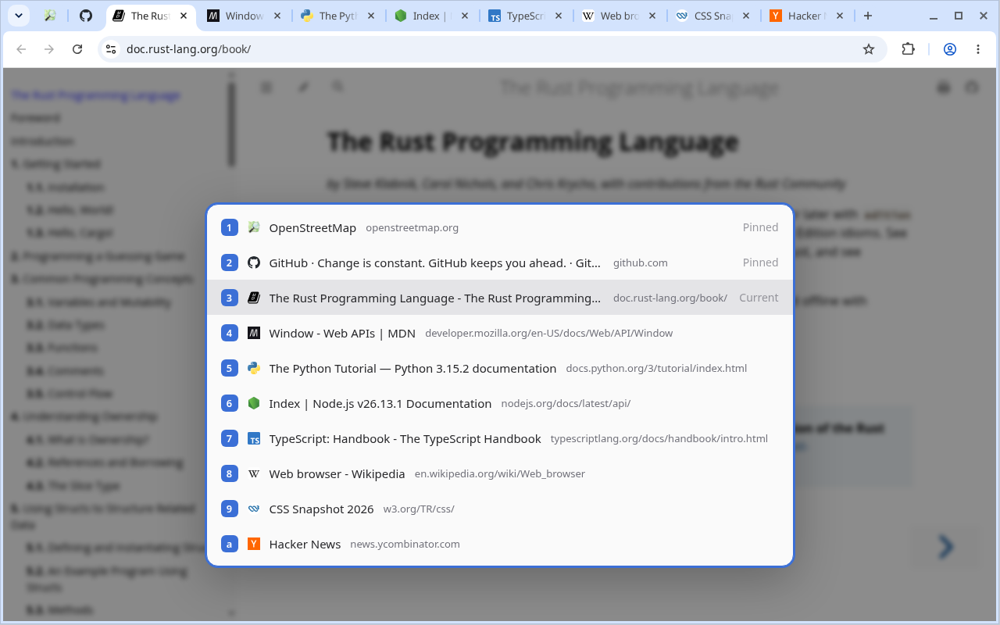

# One Search To Rule Them All

Spotlight-Like Search that fixes New Tab + Search for all Chromium Browsers.

Press Ctrl+T and a search bar opens over the page you are on. No tab opens until you pick something: an open tab, an address, a search, a page from your history or a browser action.



## Install

From the [Chrome Web Store](https://chromewebstore.google.com/detail/ofcghgcepialnjkeghndofphhdaokdeg), or from the [Releases](https://github.com/nanbiz/one-search/releases) page: unzip `one-search-<version>.zip`, open `chrome://extensions`, turn on Developer mode, click **Load unpacked** and pick the unzipped folder. It is built for Chromium-based browsers and tested in Chrome, Chromium, Brave, Edge, Vivaldi and Helium.

On request we'll extend to Firefox: [open an issue](https://github.com/nanbiz/one-search/issues).

## Search

It opens with **Ctrl+Shift+Space**, or with **Ctrl+T** once you [put it there](#putting-it-on-ctrlt).

- **Tabs:** with nothing typed it lists the window's tabs. Type part of a title or address to switch to a tab in any window.
- **Addresses and searches:** type one and press Enter. Searches go to your browser's default search engine.
- **One site:** pick a site that has its own search, press Tab and search it directly.
- **History and bookmarks:** click **Include** once. Sites you visited then come first as you type their name (*y* offers youtube.com).
- **Actions:** type *pin tab*, *duplicate*, *reload*, *copy current url*, *close other tabs*, *private window*, *print* and more.
- **Browser pages:** type *downloads*, *settings*, *extensions*, *passwords* and more.

Escape or a click beside the bar closes it. Text you typed comes back if you open it over the same tab within 45 seconds.

### Alt

Hold or tap Alt to see every tab of the window with a key. Press that key to go there, or use the arrows, which start at the current tab, and Enter. Tap Alt again to type.

### New tabs

A tab opened with the **+** of the tab strip or the menu becomes the search too, and Escape goes back to the tab you were on. Click **Allow** on *Open over the page instead of a tab* and that tab closes at once, with the search over your page.

On pages a browser keeps extensions out of, such as its settings or the Web Store, the search opens as a tab beside the page. Local files count as such pages until you click **Allow** on *Open local files* and turn on *Allow access to file URLs*.

### Putting it on Ctrl+T

An extension cannot ask for Ctrl+T, but you can give it the key once. While it is not set, the search shows **Set up** at its foot. It opens the browser's shortcuts page (`chrome://extensions/shortcuts`) in a window beside a short guide: click the pencil next to *Open a new tab* and press Ctrl+T. Chrome, Chromium, Brave and Helium take it there; Vivaldi keeps Ctrl+T for its own new tab, which becomes the search anyway.

Where the shortcuts page does not take it, the guide's **The page won't take Ctrl+T** copies the line below and opens `chrome://extensions`; there, press F12, open **Console**, type `allow pasting` and press Enter, then paste and press Enter:

```js
chrome.developerPrivate.updateExtensionCommand({ extensionId: 'ofcghgcepialnjkeghndofphhdaokdeg', commandName: 'open-overlay', keybinding: 'Ctrl+T' })
```

From then on Ctrl+T opens the search and no new tab. A copy loaded unpacked has its own id, which `chrome://extensions` shows on its card.

## The toolbar button

A click closes every tab of the window that is neither pinned nor in a tab group, apart from the one you are on; its badge shows how many that is. Click again and the search opens over the last tab, which gives way to whatever you pick.

Right-click it and untick **On** to switch the extension off.

## Coming from Zen Essentials in Chrome

Pinned tabs are no longer shared between windows; they work as your browser handles them. Helium shares them itself since 0.22.2. The first start after the update opens your pinned pages that are not open, once, as ordinary pinned tabs.

## Permissions

- `tabs` reads the address, title and icon of your open tabs to list and suggest them. Chrome describes it as "Read your browsing history".
- `favicon` shows site icons from the browser's own store. Chrome describes it as "Read the icons of the websites you visit".
- `activeTab` and `scripting` draw the search over the page you are on.
- `search` sends a search to your browser's default search engine.
- `storage` keeps settings, the searches of sites and unfinished text.
- `alarms` keeps the extension ready, so the search opens without a delay.
- `contextMenus` adds **On** to the button's right-click menu.
- Asked for only when you allow them: `history` and `bookmarks` to search them, and access to all sites to open over the page for every new tab and to learn the searches of sites you visit.

Nothing is collected; see [PRIVACY.md](PRIVACY.md).

## Develop

There are no dependencies. The tests launch a real Chromium with the extension loaded, on a private Xvfb display, and drive it over the DevTools protocol:

```
sh scripts/test-e2e.sh                     # needs chromium and xvfb-run on PATH
CHROME_PATH=/path/to/browser sh scripts/test-e2e.sh
node scripts/package.js                    # dist/one-search-<version>.zip
```

Headless Chromium fires no focus events, which is why the suite runs headed.

## License

MIT
